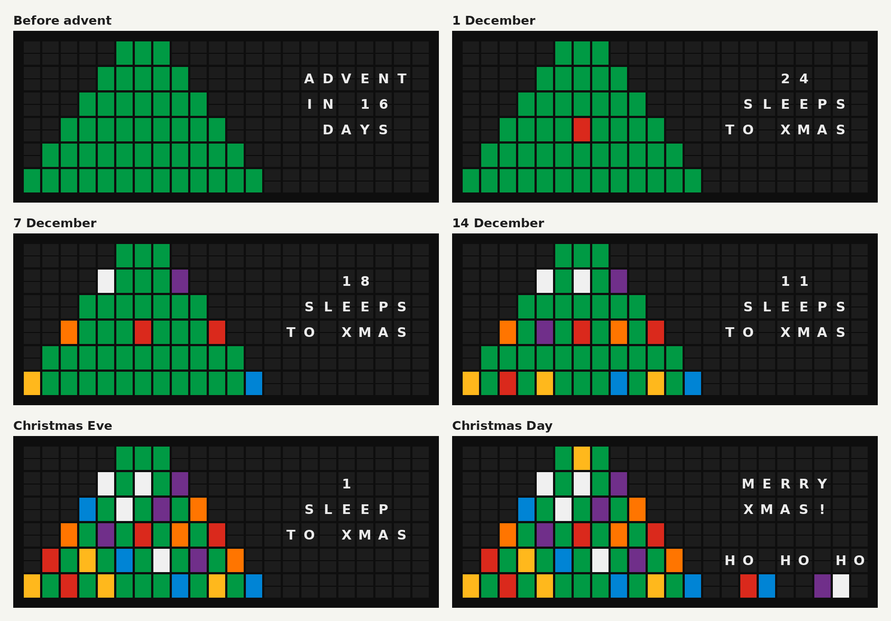
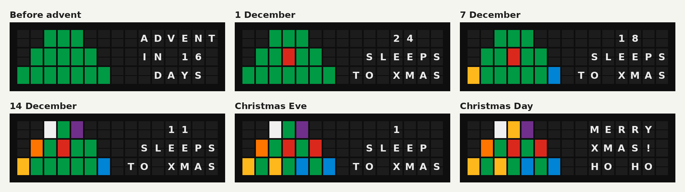

# FiestaBoard Christmas Advent Tree

A pixel-art Christmas tree for Vestaboard and other split-flap displays running
[FiestaBoard](https://fiestaboard.app), built to fill the F1 off-season.

Every day from 1 December one more bauble is hung on the tree, beside a
countdown in sleeps to Christmas. On Christmas Day the star goes on top and
presents appear underneath. **Fully offline: no API, no key, no network.**



## What it shows

| When | Tree | Caption |
| ---- | ---- | ------- |
| Before 1 Dec | Bare green tree | `ADVENT IN 16 DAYS` |
| 1–24 Dec | One more bauble each day | `18 SLEEPS TO XMAS` |
| 25 Dec | Fully decorated, yellow star, presents | `MERRY XMAS! HO HO HO` |
| 26–31 Dec | Stays decorated | `HAPPY HOLS!` |
| 1–6 Jan | Stays up until Twelfth Night | `HAPPY NEW YEAR 2027` |

A new day starts at midnight in the timezone you set, so the bauble for the
day appears overnight.

### Flagship (22×6)

A six-row tree, 3 to 13 tiles wide. Its 24 bauble slots sit on a
checkerboard, so there is exactly one bauble per day of advent and every
bauble stays framed by green even on Christmas Eve. Baubles are hung in a
fixed order that spreads them evenly over the tree, and once hung they never
move.

### Note (15×3)

The Note only has room for a three-row tree with nine bauble slots, so a
bauble appears every two or three days and the tree is full on Christmas Eve.



## Settings

| Setting | Default | What it does |
| ------- | ------- | ------------ |
| **Board Size** | `note` | `note` = 15×3, `flagship` = 22×6. |
| **Countdown Style** | `sleeps` | Count down in `sleeps` or `days`. |
| **Twinkle** | off | Shuffle the bauble colours at every refresh so the tree twinkles. The board flips more often. |
| **Timezone** | `Australia/Sydney` | Decides when a new day (and bauble) starts. |
| **Preview Day** | `0` | Pretend it is this day of December (1–31) to preview the tree. `0` uses the real date. |
| **Refresh Interval** | `300` | How often FiestaBoard asks for data. The tree only changes once a day unless Twinkle is on. |

## Template variables

Use `{{advent.line1}}` to `{{advent.line6}}` for the full pre-built board
(the demo templates do this). For your own layouts there are also
`advent.headline` (e.g. `18 SLEEPS TO XMAS`, fits a Flagship row),
`advent.sleeps`, `advent.door`, `advent.count_label`, `advent.days_to_advent`
and `advent.phase` (`PRE`, `ADVENT`, `XMAS`, `HOLS`, `NEWYEAR`).

## Install

Same as the F1 plugin: push this folder to a **public** GitHub repository
named `fiestaboard-plugin--advent` and install it from **Integrations →
Install Plugin from Git**, or copy the folder into FiestaBoard's
`external_plugins/` directory and restart. Keep the folder name: the plugin
id (`advent`) comes from it.

## Development

```bash
pip install pytest
python -m pytest tests -q
```

The tests run standalone (a stub of FiestaBoard's `PluginBase` is installed
when the real one is missing). `tools/render.py` redraws the preview images
in `docs/` (needs Pillow).

## License

MIT
